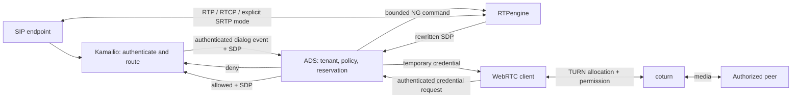

# Phase 02: Optional media gateway — research

Researched: 2026-10-27. Confidence: HIGH for protocol boundaries and documented
backend controls; MEDIUM for the proposed integration until pinned interoperability
tests run. This document plans work only; no services were installed or deployed.

<user_constraints>
## User Constraints (from CONTEXT.md)

### Authorized direction — copied verbatim

Extend the standalone open-source proxy with an optional media gateway suitable
for later use in a managed cloud platform. All media listeners/services are off
by default. Existing HTTP proxy behavior must be unaffected when disabled.

Separate platform authorization/control, SIP signaling, and RTP/RTCP media.
Integrate mature SIP signaling software and RTPengine rather than implement a SIP
transaction/dialog stack or full session border controller. Include authenticated
TURN integration for WebRTC/NAT traversal, with explicit limits on revocation,
bandwidth enforcement and transport support rather than invented backend APIs.
Keep packet forwarding out of HTTP body inspection and AI workers. Encrypted
media remains opaque unless a separately configured, documented termination mode
is explicitly enabled; no recording/transcription/transcoding by default.

### Planning assumptions — copied verbatim

Use Kamailio as the first SIP reference adapter, RTPengine for media, and coturn
for TURN, subject to official documentation, licensing and pinned interoperability
verification during implementation. OpenSIPS is an alternative behind the adapter
boundary; do not implement two SIP backends initially. Initial deployment is
single-region, single-owner per call with configured backend endpoints. No promise
of distributed quota enforcement, call migration or fleet high availability.

Plan native SIP call flow separately from standalone TURN credentials; TURN is
not automatically a SIP media relay replacement. Define who rewrites SDP, who
owns offer/answer transitions and cleanup, and how authenticated SIP/backend
identity maps to the existing immutable platform principal and tenant context.

### Non-goals — copied verbatim

Carrier SBC feature parity; PSTN billing/emergency calling; arbitrary SIP helper
support; transparent interception; transcoding/recording/AI inspection; browser UI;
multi-region seamless call handoff; homegrown cryptography or SIP stack. Deferred
features must remain visible in the roadmap rather than disappearing from scope.

Provenance: [VERIFIED: local 02-CONTEXT.md]. Recommendations below are marked
**Proposed**, not represented as additional user-mandated decisions.
</user_constraints>

## Summary

Use external Linux media services and keep ADS responsible for admission, tenant
ownership, lifecycle and management. RTPengine supports SDP rewriting and media
bridging, while coturn implements authenticated allocations; neither is replaced
by the existing fixed-target UDP relay. [CITED: [RTPengine overview](https://rtpengine.readthedocs.io/en/latest/overview.html)]
[VERIFIED: local internal/proxy/udp_proxy.go]

**Proposed primary design:** Kamailio authenticates SIP peers and owns SIP
transactions/dialog routing; it sends bounded authenticated events to ADS. ADS is
the **sole RTPengine NG controller** for a call. RTPengine returns rewritten SDP,
which Kamailio places in the SIP message. Do not concurrently invoke Kamailio's
`rtpengine_manage()` on these same calls. Use a separate authenticated ADS endpoint
to issue coturn credentials. This preserves one owner for allocation, cleanup and
quota reservations rather than creating two competing SDP controllers.

Run the new manager as optional `cmd/ads-media`, separate from `cmd/proxy`, using
external Kamailio/RTPengine/coturn processes. This is the root planning default,
not a protocol requirement. Keep DTOs in `internal/config` or a leaf package;
runtime `internal/media` may import auth/policy, but configuration must not import
runtime media and create `config → media → policy → auth → config` cycles.
Use separate mTLS service authorization for SIP callbacks and tenant/operator
permissions for management; a signaling service credential is not an end-user key.

## Architectural Responsibility Map

The assignments below are proposed design choices.

| Capability | Primary owner | Boundary |
| --- | --- | --- |
| SIP parsing, authentication, retransmission/transactions, dialog routing | Kamailio | Never implement a new SIP parser/state machine in the HTTP proxy |
| Trusted tenant mapping, CEL admission, idempotency, quotas | ADS media manager | Authenticated signaling events; no trust in SIP From or arbitrary tenant headers |
| Offer/answer/delete/query commands | ADS RTPengine adapter | Sole controller; backend endpoint is operator configured |
| SDP parsing/rewriting and RTP/RTCP forwarding | RTPengine | Media packet path bypasses ADS HTTP/AI pipeline |
| TURN credential issuance | ADS | Verified identity and tenant-scoped issuance permission |
| TURN authentication, allocation, permissions, relay limits | coturn | Credential issuance is not an allocation acknowledgment |
| Durable ownership/reconciliation | ADS state store + backend query | Single owner initially; no call migration guarantee |
| Process lifecycle | service supervisor + ADS drain orchestration | ADS does not shell out to dynamically install/spawn untrusted commands |



## Standard Stack

| Component | Verified evidence | Proposed implementation pin |
| --- | --- | --- |
| Kamailio | SIP server; official 6.1.0 release dated 2026-02-18; 6.1 module docs exist. [CITED: [release notes](https://www.kamailio.org/w/kamailio-v6-1-0-release-notes/)] | Select a supported 6.1.x patch and exact image/source digest during integration setup; no floating `latest` |
| RTPengine | NG accepts cookie-correlated commands including offer, answer, delete, query; HTTP `/ng` accepts JSON or bencode. [CITED: [NG](https://rtpengine.readthedocs.io/en/latest/ng_control_protocol.html), [HTTP interface](https://rtpengine.readthedocs.io/en/latest/http_websocket_support.html)] | Verify a maintained release against the selected protocol; official release list exposes 26.2.1.0. [CITED: [releases](https://github.com/sipwise/rtpengine/releases)] |
| coturn | Official latest release resolves to `docker/4.18.0-r0`, associated with coturn 4.18.0, dated September 8. [CITED: [release](https://github.com/coturn/coturn/releases/tag/docker/4.18.0-r0)] | Candidate 4.18.0 plus immutable image digest; security/advisory and feature verification required at execution |
| Go adapter code | Existing module uses Go, `net/http`, `crypto`, and Go tests. [VERIFIED: local source] | Prefer standard library HTTP/JSON/HMAC/TLS; no new SIP or RTP library in ADS |

Exact compatible image digests are **not verified** by this planning run. Pinning,
license manifests and real-backend tests are implementation deliverables, not
reasons to pretend a tested runtime stack already exists. [ASSUMED: candidate
version combination interoperability]

### Licensing and package provenance

Kamailio identifies its main license as GPLv2 with some BSD portions; RTPengine's
repository supplies GPLv3 text; coturn supplies a three-clause BSD-style license.
[CITED: [Kamailio README](https://raw.githubusercontent.com/kamailio/kamailio/master/README.md),
[RTPengine LICENSE](https://raw.githubusercontent.com/sipwise/rtpengine/master/LICENSE),
[coturn LICENSE](https://github.com/coturn/coturn/blob/master/LICENSE)]
Proposed packaging: separate services, record exact upstream source/license and
distribution notices with each pinned artifact. Do not infer legal exemption merely
from process separation. This is component identification, not a legal conclusion.

No npm/PyPI/crates packages are proposed or installed. Context7 tools and `ctx7`
CLI were unavailable; primary upstream docs were used. `slopcheck` was unavailable;
no package installation was attempted under the planning-only scope. Artifact
registry/digest verification remains an explicit execution task. [VERIFIED: tool
discovery and local command probes]

## Architecture Patterns

### Integration with this repository

- `auth.Principal` is defensively copied and retrieved from a private context key;
  it includes tenant and expiry. `api/scoped.go` currently permits only findings
  and AI scopes. Media actions need explicit additional permissions, not reuse of
  a global administrator key. [VERIFIED: internal/auth/principal.go, internal/api/scoped.go]
- `policy.NewVerifiedInput` describes HTTP request/client/user inputs. Add a
  dedicated typed media input/decision adapter rather than encoding SDP inside an
  invented HTTP request. Preserve the versioned decision contract. [VERIFIED:
  internal/policy/contract.go; Proposed extension]
- Put optional configuration in `internal/config/media.go`, lifecycle/ports in
  `internal/media`, backend code in `internal/media/rtpengine` and
  `internal/media/turn`, API handlers in `internal/api/media.go`, and reference
  services/fixtures under `deploy/media` and `tests/media`. These are proposed new
  paths. Actual opaque UDP relay is `internal/proxy/udp_proxy.go`, not
  `quic_relay.go`. [VERIFIED: local file listing]

### SIP event contract and idempotency — proposed

Use mTLS service identity restricted to an operator-configured signaling peer and
tenant set. The peer asserts a previously authenticated SIP principal; bind its
allowed tenant mapping server-side. Payload must include opaque platform session
ID, SIP Call-ID, From/To tags, branch, CSeq number/method, event type and SDP where
required. Keep a stable hashed backend dialog key incorporating tenant + signaling
peer + Call-ID + the original initiator tag. As refined by the execution plans,
transaction branches belong to operation identity, not the persistent call quota
key; later branches and reverse-direction wire tags resolve the same dialog. Never permit a client-supplied raw call ID to delete another tenant's
backend allocation.

Initial supported profile: nonforking early-offer INVITE, tagged 183/200 answers,
ACK without SDP, BYE, CANCEL/failure cleanup, and serialized re-INVITE/UPDATE
offer/answer for hold/resume. Reject unsupported late offer, SDP in ACK, multiple
fork branches, multipart bodies and unverified endpoint changes before forwarding.
Kamailio retains protocol response selection; ADS returns structured reasons.

Reserve capacity before sending an offer. Identify an operation by session,
branch, CSeq, method and SDP digest; replay the exact previous result for identical
duplicates and reject conflicting duplicates. On CANCEL-versus-200 and timeout,
retain a tombstone and reconcile late backend success before releasing capacity.
Track `reserved → offered → established → terminating → closed` plus `uncertain`;
an unanswered backend command must not immediately free a quota reservation.

NG `answer` requires a To tag; deletion can be scoped with tags and branch.
Cookie matching detects retransmissions. [CITED: [NG mr26.0 reference](https://rtpengine.readthedocs.io/en/mr26.0/ng_control_protocol.html)]
Proposed tests must determine which pinned backend operations are safely replayable
and when query/delete reconciliation is necessary.

### Backend transport — proposed

Prefer bounded HTTP `/ng` with JSON to avoid a new bencode parser. It is a backend
protocol, **not** an arbitrary public proxy endpoint. Pin URL, forbid redirects,
verify TLS, bound request/response sizes and command concurrency, set deadlines,
verify response cookie/result, and expose only ping/offer/answer/query/delete.
Use private network isolation and an authenticated TLS gateway where the selected
RTPengine build cannot prove caller authentication. Do not claim that HTTPS alone
authenticates a client. The documented HTTP framing is cookie + space + body.
[CITED: [HTTP interface](https://rtpengine.readthedocs.io/en/latest/http_websocket_support.html)]

## TURN semantics and enforcement limits

coturn's shared-secret mode generates an expiry-bearing username and HMAC-SHA1
password; coturn still authenticates through TURN's credential exchange. The
"REST API" label is a credential construction convention, not evidence of an
HTTP session-allocation or per-user disconnect API. [CITED:
[coturn README](https://raw.githubusercontent.com/coturn/coturn/master/README.turnserver)]

```text
# Documented coturn credential construction (use Go standard crypto primitives):
username = expiryUnixSeconds + ":" + opaqueUserIdentifier
password = Base64(HMAC-SHA1(sharedSecret, username))
```

Proposed issuance: tenant-scoped authenticated endpoint, `Cache-Control: no-store`,
fixed configured TURN URLs/realm, bounded TTL, issuance rate cap, no secret in
response/logs, and a stable opaque tenant/user suffix. Do not embed email addresses.
No arbitrary peer destination may be authorized merely by issuing a credential.

coturn provides per-user allocation quota, total allocation quota, session
`max-bps`, and aggregate `bps-capacity`; default zero means unbounded for several
of these controls. [CITED: [coturn config](https://github.com/coturn/coturn/blob/master/examples/etc/turnserver.conf)]
**Derived planning constraint:** issuance count is not active allocation count;
multiple usernames/credential refreshes can undermine naive per-user accounting.
For the first strict-tenant deployment, select dedicated coturn realm/process/port
pool partitions whose actual enforcement is proven in tests. A client-supplied
ORIGIN/realm must not become tenant identity. Shared-backend hard tenant limits
must remain unavailable until a tested backend mechanism enforces them.

Do not promise immediate credential revocation or active-allocation teardown from
stopping issuance alone. Test expiration, Refresh, secret rotation and existing
allocations against the pinned server; document the measured revocation window.
Keep backend max allocation lifetime bounded and disable unauthenticated mode.
[ASSUMED: exact active-allocation expiry/revocation behavior of chosen build —
mandatory interoperability test rather than a claimed guarantee]

## Media, NAT and capacity

RTPengine documents Linux support, IPv4/IPv6 bridging, configurable advertised
addresses, ICE handling, SDES and DTLS-SRTP, and userspace fallback when its kernel
module is unavailable. [CITED: [overview](https://rtpengine.readthedocs.io/en/latest/overview.html)]
Proposed launch matrix: plain RTP/RTCP on explicitly permitted trunks; encrypted
passthrough only where interoperability tests prove no key termination; an
explicit opt-in SRTP termination/bridging profile later. Never equate an ICE flag
or SDP transport name with preservation of end-to-end encryption. Packet captures
in isolated synthetic fixtures must verify mode behavior, without retaining real
customer media. Defer transcoding/recording and unnecessary NG flags.

RTPengine `max-sessions` caps concurrent sessions and `max-bandwidth` rejects new
sessions based on aggregate receive traffic; it is not a per-tenant packet shaper.
Port ranges and session/drain settings are documented. [CITED:
[RTPengine manual](https://rtpengine.readthedocs.io/en/latest/rtpengine.html)]
Proposed strict tenant bandwidth: dedicated relay pool with host/network shaping,
or disable that guarantee until tested. Keep negotiated admission budgets distinct
from measured actual bitrate. Do not assume two UDP ports per call: reserve a
bounded media-component budget and verify actual usage for RTCP mux/multiple media.

## Don't Hand-Roll / Common Pitfalls

Proposed prohibitions: no custom SIP parser, STUN/TURN protocol, SDP regex rewriting,
SRTP cryptography, or RTP packet forwarding in the ADS request pipeline. Use upstream
services and standard Go cryptographic primitives for documented credential format.

Release-blocking cases: two SDP owners; timeout releasing live reservations;
cross-tenant Call-ID collisions; forwarding to private/metadata/multicast peers;
unbounded SDP/control bodies; client-selected NG flags; treating silence/hold as
call death; retry storms; exposing SDP keys/ICE passwords in logs; policy changes
silently cutting existing calls; unproven claims of hard bandwidth/revocation.
These are proposed threat/test cases, not claims that every backend exhibits them.

## Project Constraints (from AGENTS.md)

The inherited `/Users/ryan/development/AGENTS.md` requires code-review-graph tools
before source exploration, then fallback when graph coverage is missing. Graph
tools were unavailable in this child tool catalog; parent had already verified
stale/missing graph coverage for new platform files. No root AGENTS.md was found.
Use graph-first impact/tests queries during implementation when available.
[VERIFIED: tool discovery, parent context, local AGENTS.md]

## Environment Availability

| Dependency | Observed state | Execution requirement |
| --- | --- | --- |
| Docker CLI | 29.7.2 present | Verify working Linux daemon/network capabilities before real integration |
| Kamailio, RTPengine, coturn, SIPp | CLI names absent from PATH | Pinned Linux fixture services/test tools must be provisioned in implementation |
| Context7/ctx7/slopcheck | Unavailable | Official upstream docs used; no package downloads in planning |

[VERIFIED: local `command -v` and `docker --version` probes]. A CLI's presence is
not proof of a usable daemon or real NAT testing. No live backend interoperability
was performed. Mock tests cannot substitute for release gates.

<phase_requirements>
## Validation Architecture and Requirement Coverage

Existing tests use Go `testing` and testify; race checks run with
`ASDF_GOLANG_VERSION=1.25.7`. [VERIFIED: repository tests and toolchain history]
Proposed future commands below require implementation; they do not exist yet.

| Requirement | Planned evidence | Test tier |
| --- | --- | --- |
| MG-01 | disabled config opens no sockets/starts no backend goroutines; existing suite unchanged | Go config/lifecycle |
| MG-02 | spoofed SIP tenant rejected, mTLS peer map, scope/tenant API isolation, CEL default deny | Go + SIP fixture |
| MG-03 | duplicate/conflicting offers, CSeq races, reservation rollback, crash/reconcile | race + fault injection |
| MG-04 | INVITE/183/200/ACK/BYE, CANCEL race, re-INVITE hold/resume; unsupported flows rejected | real Kamailio |
| MG-05 | bad cookies/results, timeout, delete retry, real offer/answer media counters | adapter + RTPengine |
| MG-06 | valid/expired credentials, Refresh, permission denial, quota exhaustion, rotation window | real coturn |
| MG-07 | two-way media across separate network namespaces/NAT; RTCP, IPv4/6, selected SRTP profile | Linux integration |
| MG-08 | packet flood, port exhaustion, username refresh bypass, explicit shaping evidence | measured backend load |
| MG-09 | no SDP/keys/media in telemetry; bounded labels; counters match synthetic known workload | privacy + reconciliation |
| MG-10 | backend loss, restart, drain, no new allocations, eventual port release; HTTP regression | end-to-end release gate |

Per-task fast command: `ASDF_GOLANG_VERSION=1.25.7 go test ./internal/media/...`.
Per-wave: `ASDF_GOLANG_VERSION=1.25.7 go test -race ./internal/media/... ./internal/api ./internal/config`.
Release: `tests/media/run.sh` must fail if required services are unavailable,
then `go test ./...`, `go vet ./...`, `go build ./...`. Archive fixture versions,
network topology, loss/jitter/latency results and teardown counters; do not invent
throughput targets before baseline measurement. Proposed validation plan.
</phase_requirements>

## Security Domain

Use a threat model for authentication, session ownership, access control, input
validation, crypto/key handling and resource exhaustion. These are design domains,
not an ASVS certification or a claimed version-specific ASVS checklist. Require
peer-address deny rules and routing/firewall defense for both address families;
test IPv4-mapped IPv6 and link-local/metadata destinations. Fail new admissions
closed on policy/control outage while keeping cleanup paths available. Proposed.

## Assumptions Log / Open Questions

| Item | Planning treatment |
| --- | --- |
| Exact backend version/digest combination | Unverified; pin and verify before building deploy artifacts |
| Existing TURN allocation expiry/revocation | Unverified for selected build; real-server tests and explicit measured guarantee |
| Hard tenant bandwidth on shared RTPengine | Not established by researched admission controls; require shaping/dedicated partition or defer guarantee |
| Native SIP credential source | Proposed configured authenticated trunk mapping initially; do not imply OIDC directly authenticates arbitrary SIP clients |
| Initial SIP complexity | Proposed early-offer, no forks; unsupported cases fail explicitly until fixtures expand coverage |
| Media/control availability expectations | Single owner, no live call migration; production HA is a later milestone |

Research sources are inline. Current upstream docs describe capabilities, not
proof that the selected deployment, security controls or interoperable version
combination already works. Refresh version/advisory/digest checks at execution.
