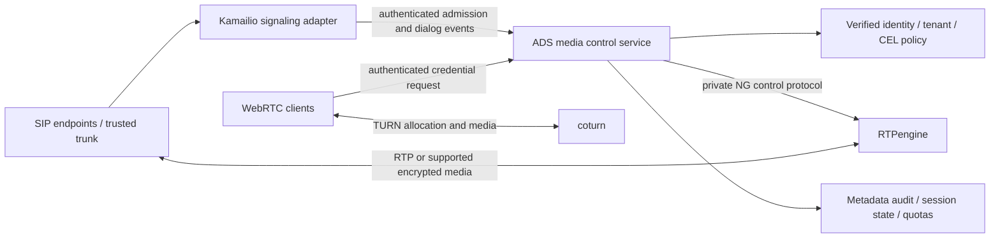

# Optional media gateway plan

**Status: proposed implementation; no media runtime has been added.**

The media gateway extends the standalone proxy and can later be operated as part
of the cloud platform. It is independently enabled, deployed, scaled and drained.
Ordinary HTTP proxy installations require no SIP/media dependencies or open ports.
The proposed control-service entry point is `cmd/ads-media`; `cmd/proxy` retains
its existing role. Both can share configuration/identity/policy contracts without
sharing request-processing or media packet loops.

## Proposed architecture

Kamailio, RTPengine and coturn are the recommended first reference integrations,
not mandatory long-term vendor interfaces. Implementation must pin and test their
versions and record their licenses. OpenSIPS can follow behind the signaling
adapter boundary; the initial release should not maintain two SIP integrations.

**ADS owns RTPengine allocation and SDP transformation.** The Kamailio bridge
passes authenticated, ordered offer/answer events to ADS and applies the returned
SDP. It must not independently call `rtpengine_manage` for the same calls. SIP
transaction handling stays with Kamailio. Media packets stay with RTPengine/coturn;
they do not traverse HTTP body scanners or AI workers.

SIP media and standalone TURN are separate flows. TURN credential issuance does
not establish a SIP dialog and does not force an unmodified application to use
the relay. Clients must support the configured proxy/ICE/TURN path.

## First-release boundaries

- Off by default, with separate configuration, management permissions and ports.
- Single region and one controller owner per SIP call; no seamless failover or
  migration of live calls between controllers.
- Explicit tested SIP/SDP subset, including lifecycle and retransmission behavior;
  unsupported extensions must be rejected or remain clearly unsupported.
- Verified accounts/trunks map to platform tenants; SIP `From`, HTTP tenant
  headers and body-supplied tenant IDs do not establish identity.
- CEL decides admission and permitted destinations; reservations enforce supported
  quotas atomically. No per-packet remote policy/model calls.
- Preserve encrypted media by default. Terminating SRTP/DTLS-SRTP or translating
  crypto modes requires a separately enabled, tested mode and trust-boundary docs.
- Metadata-only audit and QoS, with bounded retention and metric cardinality.
- No recording, transcription, transcoding, PSTN billing, emergency-call routing,
  transparent interception or full session-border-controller claim.

## Operational invariants

1. Authorization happens before backend allocation; allocation failures release
   reservations or leave a bounded, retryable cleanup record.
2. Every call/branch has a tenant-bound internal identifier. Raw SIP Call-ID alone
   is not a global database key or authority to change another call.
3. Retransmitted requests cannot allocate twice. Delayed replies cannot resurrect
   a closed session or overwrite a newer SDP generation.
4. Peer/media destinations are validated, including SDP and ICE candidates. Private
   enterprise networks can be explicitly permitted; arbitrary internal/metadata
   destinations and unknown peers are not accepted by default.
5. Declining new calls during drain does not immediately kill healthy calls.
   The configured drain deadline eventually tears down owned allocations.
6. TURN credential expiry, allocation lifetime, revocation and active-call quota
   are different concepts. The API and documentation must expose those limits.
7. Backend receive-bandwidth admission thresholds are not per-tenant packet
   shaping. Hard guarantees require a tested backend/partition enforcement path.
8. New admissions fail closed when required authorization/backend state is
   unavailable; recovery of existing sessions follows an explicit reconciliation
   policy rather than a claim of automatic high availability.

## Delivery and review

Detailed plans, research, dependency waves, acceptance tests and requirement
coverage live in [.planning/phases/02-media-gateway](../.planning/phases/02-media-gateway/).

| Plan | Deliverable |
| --- | --- |
| [01](../.planning/phases/02-media-gateway/02-01-PLAN.md) | Default-off configuration and typed contracts |
| [02](../.planning/phases/02-media-gateway/02-02-PLAN.md) | Trusted identities, media CEL admission and scoped APIs |
| [03](../.planning/phases/02-media-gateway/02-03-PLAN.md) | Durable reservations and idempotent session lifecycle |
| [04](../.planning/phases/02-media-gateway/02-04-PLAN.md) | Bounded RTPengine adapter, destination validation and crypto profiles |
| [05](../.planning/phases/02-media-gateway/02-05-PLAN.md) | Kamailio signaling integration and supported call flows |
| [06](../.planning/phases/02-media-gateway/02-06-PLAN.md) | TURN credentials and enforceable tenant partitions |
| [07](../.planning/phases/02-media-gateway/02-07-PLAN.md) | Service assembly, recovery, drain and metadata telemetry |
| [08](../.planning/phases/02-media-gateway/02-08-PLAN.md) | Pinned Linux fixtures, interoperability, failure/load and release gates |

Execution follows dependencies, not numeric order: 01 → (02 and 04) → 03 →
(05 and 06) → 07 → 08. Parallel plans have separate file ownership.

Execution starts with configuration, contracts and disabled-mode tests, then a
working SIP/media vertical slice and standalone TURN. Real backend fixtures and
failure/load tests are required before enabling an external listener.

The current engine/cloud backlog remains open. This plan does not substitute for
Squid compatibility testing, distributed tenant quotas or cloud fleet operations.
